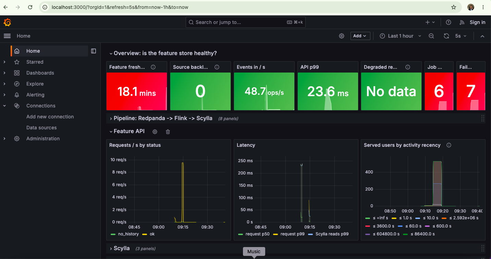

# data_platforms

Hands-on, local data-platform projects: streaming, CDC, batch orchestration on Spark or
[Sail](https://github.com/lakehq/sail), and real-time feature serving. Each project is self-contained (its own `docker-compose.yml`, README and
monitoring) and runs on a laptop with Docker.

## Projects

| Project | What it shows | Stack |
|---|---|---|
| [**feature_store**](feature_store/) | Real-time user features for fraud / credit-risk APIs: today, MTD, YTD, 12-month monthly history (seasonality), hourly velocity and profile attributes, served in single-digit milliseconds. Includes parity checks against raw events, crash recovery, blue/green rebuilds and a backfill design. | Redpanda, Flink (Java), ScyllaDB, FastAPI, Prometheus, Grafana |
| [**spark_scheduler**](spark_scheduler/) | A small self-hosted scheduler for Spark jobs without Airflow: cron schedules, per-job retry policies, timeouts and concurrency limits, REST API and CLI. Each job runs on Spark or on [Sail](https://github.com/lakehq/sail), with a [Spark vs Sail benchmark](spark_scheduler/bench/README.md) of an ingestion pipeline. | Spark 3.5 standalone, Sail 0.7, Delta Lake, MinIO, Postgres, Prometheus, Grafana |
| [**sail_lab**](sail_lab/) | A sandbox for Sail on its own, with no scheduler: submit PySpark jobs, uploaded scripts or SQL, then follow each run in Grafana through Sail's own operator metrics, query traces and logs. Includes Delta, Iceberg, UDF and spill examples, plus a table of Sail-vs-Spark findings. | Sail 0.7, PySpark 3.5 (Spark Connect), MinIO, FastAPI, OpenTelemetry, Prometheus, Loki, Tempo, Grafana |
| [**cdc_monitoring**](cdc_monitoring/) | Change Data Capture from Postgres into Redpanda with Debezium, and a Python consumer turning order events into live metrics. | Postgres, Debezium, Redpanda, Python, PushGateway, Prometheus, Grafana |
| [**kafka-local**](kafka-local/) | A 3-broker Kafka cluster with JMX metrics, used for producer experiments (`acks=0/1/all`) and to see where produce latency goes. | Kafka + ZooKeeper, JMX exporter, Prometheus, Grafana |



## How they fit together

```
 OLTP (Postgres) ──Debezium CDC──▶ Redpanda / Kafka ──▶ Flink ──▶ ScyllaDB ──▶ Feature API ──▶ fraud / credit models
   cdc_monitoring                    kafka-local          feature_store (online, real time)
                                                                       │
                                     Spark + Delta Lake on MinIO ◀─────┘ offline / batch (spark_scheduler)
```

- **cdc_monitoring** is how operational tables get onto the event bus.
- **kafka-local** looks at the bus itself: durability settings and their latency cost.
- **feature_store** turns events into low-latency features for online decisions.
- **spark_scheduler** runs the batch side: scheduled Spark/Delta jobs on object storage, each on Spark or on Sail. The feature store's backfill design (see its README) is where the two meet.
- **sail_lab** is a place to experiment with Sail directly and see what the engine does on each run.

## Batch jobs on Spark or Sail

[Sail](https://github.com/lakehq/sail) is an open-source Rust engine that speaks the Spark Connect
protocol, so PySpark DataFrame and SQL code runs on it without a JVM. In **spark_scheduler** every
job picks its engine with one line, and the same script runs on either:

```yaml
jobs:
  - name: orders_pipeline_spark
    app: /opt/sparksched/jobs/ingest_pipeline.py      # engine: spark is the default
  - name: orders_pipeline_sail
    engine: sail                                      # same script, run on the Sail server
    app: /opt/sparksched/jobs/ingest_pipeline.py
```

- **Spark** jobs go through `spark-submit` to the standalone cluster.
- **Sail** jobs run as plain Python over Spark Connect to the `sail` service.
- **Shared by both:** retries, timeouts, cancel, concurrency limits, status, metrics and the
  Grafana table. On cancel or timeout the Sail runner also interrupts the job's Spark Connect
  session, because Sail keeps running a query after its client dies.
- **Delta tables are interchangeable:** a test reads, with Spark, a table that Sail wrote.
- **What Sail doesn't support:** RDDs, delta-spark's `DeltaTable` Python API, and some Delta write
  options. Details are in the
  [spark_scheduler README](spark_scheduler/README.md#running-jobs-on-sail).

### Spark vs Sail on an ingestion pipeline

[The benchmark](spark_scheduler/bench/README.md) runs one pipeline on both engines, each in a
resource-capped container: schema checks, a quarantine table, dedup, and a Delta `MERGE`. The input
is two batches of about 4.1M raw events, merged into a 2.08M-row silver table. Both engines produced
identical tables.

| Run | Time | CPU-seconds | Result |
|---|---|---|---|
| Spark, 4 CPU / 3 GB (baseline) | 349–363 s | ~1,100 | ok |
| **Sail, 0.8 CPU / 3 GB (⅕ of the CPU)** | **381 s** | **298** | ok |
| Sail, 0.8 CPU / 614 MB (⅕ of CPU and memory) | – | – | MERGE runs out of memory |
| Sail, 4 CPU / 3 GB (same as Spark) | 249 s | 855 | ok, 1.4× faster |
| Spark, 0.8 CPU / 3 GB (same as Sail) | 726 s | 578 | ok, Sail is 1.9× faster |
| Smallest passing config at 0.8 CPU | Spark: 1.25 GB, 715 s · Sail: 1.75 GB, 409 s | | |

- **CPU:** Sail matched Spark's 4-CPU time on a fifth of the CPU, with about 3.7× fewer
  CPU-seconds. The gain is mostly in reading, validating and deduplicating JSON, which is about 4×
  faster. The Delta MERGE is only about 1.3× faster.
- **Memory:** Sail can't run this workload in a fifth of the memory. Its MERGE needs about 1.75 GB,
  more than Spark's 1.25–1.5 GB. It also needs a bounded memory pool: with the default unbounded
  pool it grows until the container is OOM-killed.
- **Hardware:** a 2-core MacBook Air, so "4 CPUs" is 2 cores with hyper-threading. Most
  configurations ran once. Method and caveats are in the
  [benchmark README](spark_scheduler/bench/README.md).

## Running a project

Prerequisite: Docker (Docker Desktop or OrbStack). Each project is started from its own folder:

```bash
cd feature_store && make up        # see each project's README for its exact commands
```

**Run one project at a time.** They reuse the same local ports (Grafana on 3000, Prometheus on
9090, Redpanda Console on 8080, …) and each needs a good share of the Docker VM's memory. Stop one
before starting the next (`make down`, or `docker compose down`).

| Project | Docker memory | Main local ports |
|---|---|---|
| feature_store | ~4 GB | Grafana 3000, API 8000, Console 8080, Flink 8081, Prometheus 9090, CQL 9042, Kafka 19092 |
| spark_scheduler | ~6 GB; on smaller machines `MAX_CONCURRENT_RUNS=2 make up` | Grafana 3001, API 8000, Spark 8088, Sail 50051, MinIO 9000/9001, Prometheus 9095 |
| sail_lab | ~3 GB | Grafana 3002, API 8010, Sail 50052, MinIO 9010/9011, Prometheus 9097, Jupyter 8890 |
| cdc_monitoring | not measured | Grafana 3000, Console 8080, Kafka Connect 8083, Prometheus 9090, PushGateway 9091, Postgres 5432, Kafka 19092 |
| kafka-local | not measured | Grafana 3000, Prometheus 9090, brokers 9091–9093, ZooKeeper 2181 |

## Repository layout

```
data_platforms/
├── feature_store/      # Redpanda → Flink → Scylla → Feature API
├── spark_scheduler/    # cron + retries for Spark/Delta jobs, on Spark or Sail (+ bench/)
├── sail_lab/           # Sail sandbox: submit jobs, watch the engine in Grafana
├── cdc_monitoring/     # Postgres → Debezium → Redpanda → metrics
├── kafka-local/        # 3-broker Kafka + JMX metrics experiments
└── .github/workflows/  # CI (spark_scheduler: unit tests on push/PR, nightly end-to-end; sail_lab: unit tests)
```

## Conventions

- Everything runs locally; no cloud account or credentials are needed. Default local-only
  logins (e.g. MinIO `minioadmin`) are documented in the project READMEs.
- Every project ships Prometheus metrics and a provisioned Grafana dashboard.
- Each project README lists what was tested and what is simplified compared with production.
