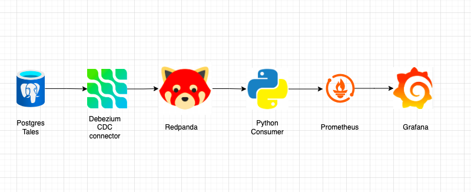
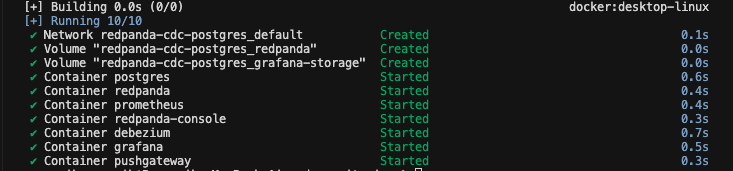
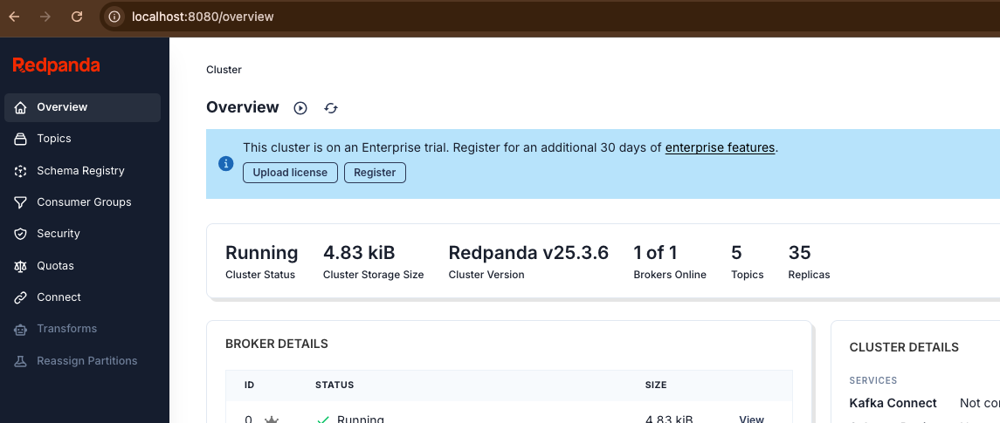
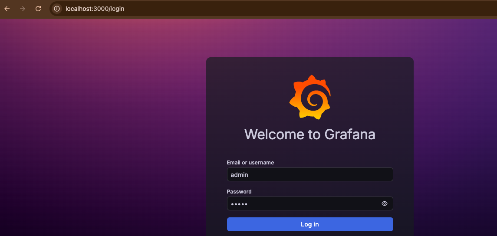
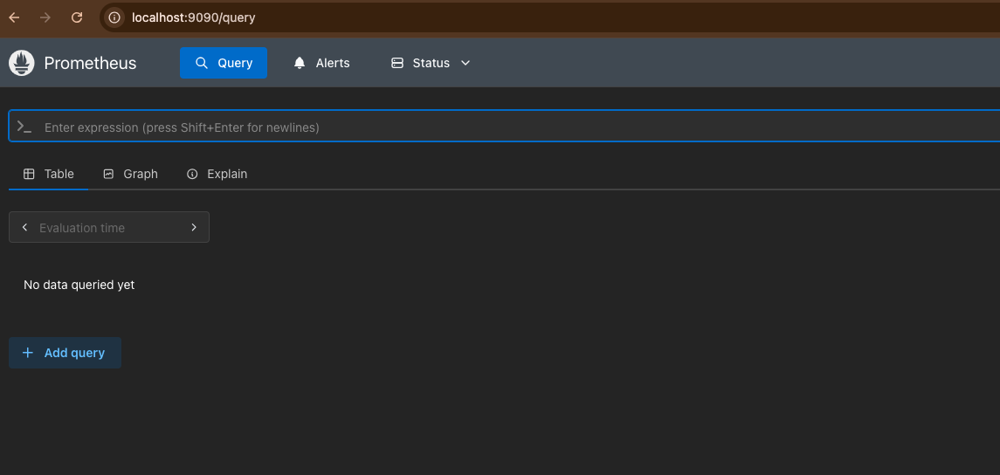
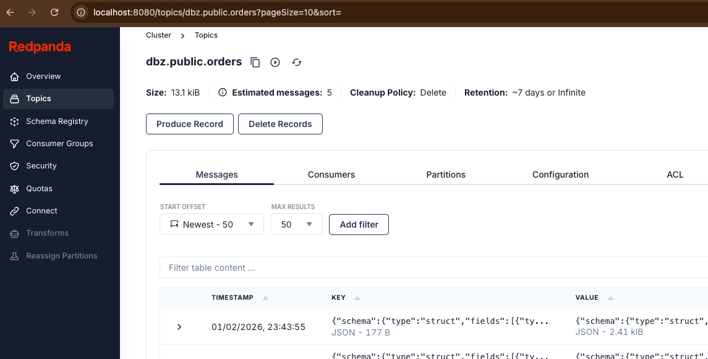
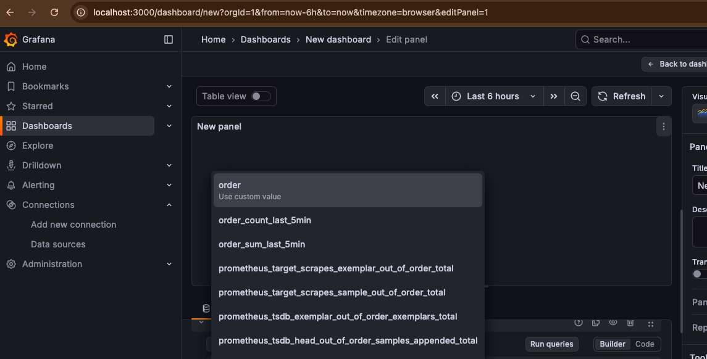
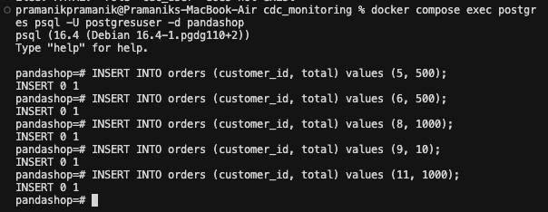
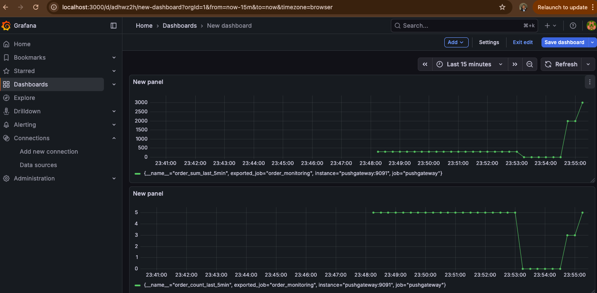

# CDC Monitoring with Debezium, Redpanda & Grafana

A real-time Change Data Capture (CDC) monitoring stack that streams PostgreSQL changes to Redpanda, collects order metrics via a Python consumer, and visualizes them in Grafana.

## Architecture Overview

This project includes:

| Component | Description |
|-----------|-------------|
| **Redpanda** | Kafka-compatible event streaming platform |
| **Redpanda Console** | Web UI for Redpanda topics and messages |
| **PostgreSQL** | Source database with `orders` table |
| **Debezium** | CDC connector capturing Postgres changes in real time |
| **Prometheus** | Metrics collection |
| **PushGateway** | Receives pushed metrics from the Python consumer |
| **Grafana** | Metrics visualization and dashboards |
| **Python Consumer** | Consumes order events, aggregates metrics, pushes to PushGateway |

### Architecture Diagram



## Prerequisites

- **Docker** or **OrbStack** up and running

## Quick Links

| Service | URL |
|---------|-----|
| Redpanda Console | [http://localhost:8080](http://localhost:8080/topics?showInternal=true) |
| Grafana | [http://localhost:3000](http://localhost:3000/?orgId=1&from=now-6h&to=now&timezone=browser) |
| Prometheus | [http://localhost:9090](http://localhost:9090) |

---

## Setup Instructions

### 1. Start the Stack

Clone the repo, then:

```bash
cd cdc_monitoring

export REDPANDA_VERSION=v25.3.6

docker compose up -d
```

This will pull and start all required images.



### 2. Verify Redpanda Console

Open [Redpanda Console](http://localhost:8080) and check the list of topics.



### 3. Configure Grafana

1. Open [Grafana](http://localhost:3000)
2. Log in with **admin** / **admin**
3. Add Prometheus as a data source: `http://prometheus:9090`



### 4. Verify Prometheus

Open [Prometheus](http://localhost:9090) to confirm metrics collection is running.



### 5. Connect to PostgreSQL

In the same terminal:

```bash
docker compose exec postgres psql -U postgresuser -d pandashop
```

Then run:

```sql
SELECT * FROM orders;
```

### 6. Create Debezium CDC Connector

Open a **new terminal** and run:

```bash
cd cdc_monitoring

docker compose exec debezium curl -H 'Content-Type: application/json' debezium:8083/connectors --data '
{
  "name": "postgres-connector",
  "config": {
    "connector.class": "io.debezium.connector.postgresql.PostgresConnector",
    "plugin.name": "pgoutput",
    "database.hostname": "postgres",
    "database.port": "5432",
    "database.user": "postgresuser",
    "database.password": "postgrespw",
    "database.dbname": "pandashop",
    "database.server.name": "postgres",
    "table.include.list": "public.orders",
    "topic.prefix": "dbz"
  }
}'
```

A new topic for the `orders` table will be created with the initial 5 records published.



### 7. Run the Order Monitoring Python Job

Open **another terminal**:

```bash
cd cdc_monitoring

source venv/bin/activate   # On macOS
pip3 install -r requirements.txt

python3 order_monitoring.py
```

This job continuously collects the last 5 minutes of order counts and averages, pushing them to Prometheus via PushGateway.

Order metrics will appear in Grafana.



### 8. Test Live CDC

In the Postgres terminal, insert new records:

```sql
INSERT INTO orders (customer_id, total) VALUES (5, 500);
```

Grafana metrics will update accordingly as changes are streamed through Debezium → Redpanda → Python consumer → Prometheus → Grafana.



---

## Grafana Dashboard

Once the pipeline is running, you can build or import a dashboard to visualize order metrics over time.



---

## Clean Up

To stop and remove all containers:

```bash
docker compose down -v
```
