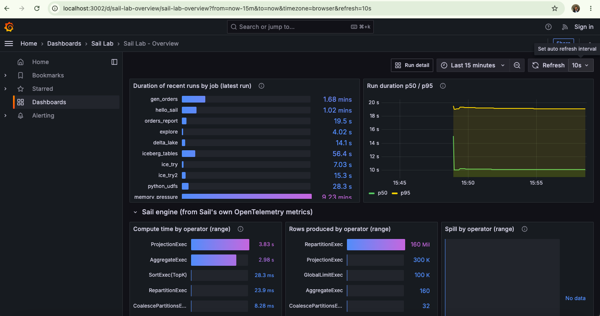
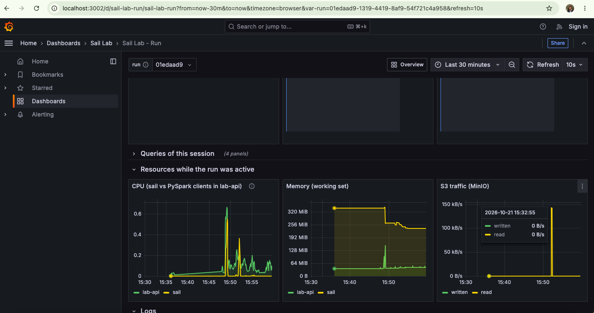

# sail_lab

A local sandbox for trying out [LakeSail Sail](https://github.com/lakehq/sail), the Rust engine
that runs PySpark code through the Spark Connect protocol, without a JVM. Submit a job, an
uploaded script or plain SQL, then follow it in Grafana: Sail's own per-operator metrics, query
traces and logs, next to CPU, memory and S3 traffic.

There is deliberately **no scheduler**: no cron, no DAGs, no retries. A run starts as soon as one
of `MAX_CONCURRENT_RUNS` slots is free. For scheduling see [spark_scheduler](../spark_scheduler/),
which can also run jobs on Sail.



## Quick start

```bash
cd sail_lab
make up                              # ~3 GB of Docker memory; first build takes a few minutes
./lab submit hello_sail.py -f        # run a job and follow its log
open http://localhost:3002           # Grafana, no login needed to view
```

`./lab` is a single-file client that uses only the Python standard library (Python 3.9+), so
there is nothing to install. `make demo` generates data and runs the main examples in order.

## How it works

```
 ./lab CLI / curl / Swagger UI
         │  POST /runs  {job | script | sql, args, conf, timeout}
         ▼
 ┌──────────────── lab-api (FastAPI) ────────────────┐
 │ queue (MAX_CONCURRENT_RUNS slots) · SQLite history │      jobs/ is mounted: edit a job,
 │ one PySpark client process per run, no JVM:        │      resubmit, no rebuild
 │ python -m saillab.bootstrap --session <run id> ... │
 └───────────────┬────────────────────────────────────┘
                 │ Spark Connect (gRPC), session_id = run id
                 ▼
          ┌─────────────┐   s3://lake/...   ┌────────┐
          │ Sail 0.7.2  │ ────────────────▶ │ MinIO  │  Parquet, Delta, Iceberg
          └──────┬──────┘                   └────────┘
                 │ OTLP: metrics, traces, logs
                 ▼
          OTel Collector ──▶ Prometheus (metrics) ─┐
          (+ tails run logs) ─▶ Loki (logs) ───────┼──▶ Grafana: Overview + Run dashboards
                             ─▶ Tempo (traces) ────┘
   lab-api /metrics, container-stats (cgroup CPU/memory), MinIO metrics ──▶ Prometheus
```

**One id everywhere.** A run's id is also the Spark Connect session id it uses with Sail. The
same UUID finds the run in the lab API, in Sail's metrics (`session_id`), in Tempo traces
(`session.id`) and in Loki logs (`run_id`). The run dashboard is built on that.

## Submitting work

| What | CLI | REST |
|---|---|---|
| A job from `jobs/` | `./lab submit delta_lake.py -- --rows 50000` | `{"job": "delta_lake.py", "args": ["--rows", "50000"]}` |
| Any local `.py`/`.sql` file (uploaded) | `./lab submit ~/scratch/try.py` | `{"script": {"filename": "try.py", "content": "..."}}` |
| SQL text, or a SQL file | `./lab sql "SELECT 1"` · `./lab sql @q.sql` | `{"sql": "SELECT 1; SELECT 2"}` |

Options for `submit` and `sql`: `-f` follows the log until the run ends, `-w` waits without
printing the log, `--conf k=v` sets a Spark session config, `--timeout 300` cancels the run after
that many seconds, and `--name` sets the metrics label. Arguments after `--` go to the script.

```bash
./lab jobs                 # what is in jobs/, with each job's docstring
./lab runs                 # recent runs
./lab show 1f3a            # full details as JSON (any unique id prefix works)
./lab logs 1f3a -f
./lab cancel 1f3a          # interrupts the Sail session, then stops the client
```

The API is documented at <http://localhost:8010/docs>. You can also submit from there.

```bash
curl -s localhost:8010/runs -H 'Content-Type: application/json' \
     -d '{"job": "orders_report.py", "timeout_seconds": 600}'
```

### Writing a job

A job is an ordinary PySpark script. `SparkSession.builder.getOrCreate()` returns the session
the bootstrap already opened for the run. To show numbers on the dashboard, optionally:

```python
from saillab.sdk import report, timed

with timed("write"):                 # reports write_seconds
    df.write.format("delta").save("s3://lake/delta/t")
report(rows=df.count())              # any JSON value; numbers also go to Prometheus
```

Outside a lab run these helpers do nothing, so a script also runs anywhere else. Helper modules
in `jobs/` whose names start with `_` can be imported and are not listed as jobs. Data goes to
MinIO: use `s3://lake/...` (`s3a://` works too).

### Using Sail directly

Port 50052 is Sail's Spark Connect endpoint. Any PySpark 3.5 or 4.x client can connect to it:

```bash
SPARK_REMOTE=sc://localhost:50052 python my_script.py
make notebook                        # JupyterLab on http://localhost:8890, already connected
```

For Python UDFs, the client must use the same Python minor version (3.10) and the same
pyspark, pandas and pyarrow versions as the server. Sail unpickles the UDFs. Code run inside
`lab-api` or the notebook already matches.

## Example jobs

| Job | Shows |
|---|---|
| `hello_sail.py` | Smoke test: an aggregation, Sail's physical plan for it (DataFusion operators), and a Python UDF |
| `gen_orders.py` | Writes 2M orders and 50k customers as Parquet. Input for the jobs below |
| `orders_report.py` | Join, aggregations, window functions (7-day revenue, top-3 per country), partitioned Parquet output |
| `explore.sql` | SQL file: external tables, CTE + window, `EXPLAIN` |
| `delta_lake.py` | Delta: create, append, `replaceWhere`, `MERGE`, `UPDATE`, `DELETE`, time travel |
| `iceberg_tables.py` | Iceberg without a catalog: append, `overwritePartitions()`, `MERGE`, time travel by timestamp |
| `python_udfs.py` | The same computation as a built-in expression, a Python UDF, a pandas UDF, `mapInArrow` and `applyInPandas`, timed |
| `memory_pressure.py` | A full sort and a high-cardinality aggregation that exceed Sail's memory pool and spill to disk |
| `long_running.py` | Keeps Sail busy. Use it to try `./lab cancel` and `--timeout` |
| `fail_demo.py` | Fails on purpose, to show how a failure looks |

## Monitoring

**Sail Lab - Overview** (the Grafana home page):
- Runs: running, queued, succeeded and failed counts, plus a recent-runs table that links to each run.
- Engine: compute time, rows and spill per operator over all queries (from Sail's own telemetry).
- Resources and storage: CPU and memory per container, Sail's memory against its limit, and MinIO traffic and requests.
- Sail's server logs.

**Sail Lab - Run** covers one run end to end. `./lab` and the API print a link that opens it on
the run's time window:
- Run details and the values the job reported (`report`, `timed`, and the bootstrap's `session_ready_seconds`).
- Compute time and rows per operator, a per-query table with spill, and live operator progress.
- Sail's query traces in Tempo (`handle_execute_plan → JobRunner::execute → one span per operator`).
- CPU and memory of `sail` and `lab-api`, and S3 traffic, during the run.
- The run's log, plus Sail server log lines mentioning the session.



| Signal | Source | Where |
|---|---|---|
| `execution_*` (rows, bytes, compute time, spill, join/aggregate details per operator) | Sail, `SAIL_TELEMETRY__EXPORT_METRICS` → OTLP | Prometheus, labelled `session_id`, `execution_job_id`, `execution_operator_name` |
| Query traces | Sail, `SAIL_TELEMETRY__EXPORT_TRACES` | Tempo, span attribute `session.id` |
| Sail server logs | Sail, `SAIL_TELEMETRY__EXPORT_LOGS` | Loki `{service_name="sail-server"}` |
| Run logs (client stdout/stderr) | OTel Collector tails `/var/log/lab/runs/<run id>.log` | Loki `{service_name="lab-run"} \| run_id="..."` |
| `lab_runs_*`, `lab_run_duration_seconds`, `lab_run_info`, `lab_run_result` | lab-api `/metrics` | Prometheus |
| `lab_container_*` (CPU, memory, limit, peak) | `container-stats`, which reads cgroup v2 files (cAdvisor can't map containers on Docker Desktop for macOS) | Prometheus, labelled `service` |
| `minio_s3_*` | MinIO | Prometheus |

Sail reports every operator metric once per partition. The collector sums partitions away, so a
run costs one series per (query, operator). The dashboards are generated by
`grafana/build_dashboards.py`: edit it and run `make dashboards`.

## Sail compared with Spark: what this lab found (Sail 0.7.2, PySpark 3.5.8)

All of these were run in this stack. The jobs above already avoid the traps.

| Topic | Finding |
|---|---|
| API surface | Spark Connect only: DataFrame, SQL, Python UDFs. There is no `sparkContext`, RDDs, or JVM (Scala/Java) UDFs and libraries. |
| Storage config | S3 is configured on the **server** through `AWS_*` env vars (`AWS_ENDPOINT`, `AWS_ALLOW_HTTP` for MinIO). Hadoop `fs.s3a.*` settings do nothing, while `s3a://` paths work. |
| Plans | `explain()` and `EXPLAIN` print Sail's DataFusion plan (`AggregateExec`, `RepartitionExec`, ...), not Spark's. |
| Python UDFs | They run inside the Sail server, which needs the client's Python minor version and pyspark/pandas/pyarrow pins. Row-at-a-time UDFs are around 100× slower than built-in expressions (`python_udfs.py`). |
| Delta | Create, append, `replaceWhere`, `MERGE`, `UPDATE`, `DELETE` and `versionAsOf` all work. Per Sail's docs, `VACUUM`, `OPTIMIZE`, `RESTORE` and Change Data Feed don't exist yet. |
| Iceberg time travel | `option("timestampAsOf", "<RFC 3339 string>")` and `TIMESTAMP AS OF '<string>'` work. `option("as-of-timestamp", <millis>)` is **silently ignored** and returns the latest snapshot. |
| Iceberg partition overwrite | `option("partitionOverwriteMode", "dynamic")` is **silently ignored**: `mode("overwrite")` then replaces the whole table. Use `df.writeTo(t).overwritePartitions()`. `replaceWhere` on Iceberg failed. |
| Memory | The default memory pool is unbounded, so a big sort can get the container OOM-killed. This stack caps it (`fair`, 1.2 GiB in a 2 GiB container). `memory_pressure.py` then spills about 2.8 GiB to disk while Sail stays near 1 GiB. |
| Cancelling | Sail keeps running a query after its client dies, so cancel calls `interruptAll()` on the run's session before signalling the client. The client then logs `operation not found` for its interrupted query. That is expected. |
| Startup | A PySpark client is ready in about 2–3 s warm, and that is almost all `import pandas`/`pyspark`. Sail itself creates a session in milliseconds. |

## Configuration

Set these in the environment of `make up`/`docker compose up`:

| Variable | Default | Meaning |
|---|---|---|
| `MAX_CONCURRENT_RUNS` | `2` | Runs executing at once; the rest queue |
| `SAIL_MEM_LIMIT` | `2g` | Sail container memory limit |
| `SAIL_MEMORY_POOL_BYTES` | `1288490188` (1.2 GiB) | Sail's memory pool; keep it below `SAIL_MEM_LIMIT` |
| `LAB_MEM_LIMIT` | `1536m` | lab-api limit (it hosts the PySpark clients, ~150 MB each) |
| `SAIL_LOG_LEVEL` | `info` | `RUST_LOG` for Sail |

To try another Sail or PySpark version: `docker compose build --build-arg SAIL_VERSION=... --build-arg PYSPARK_VERSION=...`.
The server and clients are built from one base stage, so they always match. Any Sail setting
can be added to the `sail` service as `SAIL_*` env vars
([reference](https://docs.lakesail.com/sail/latest/reference/configuration/)).

## Ports

| Service | URL |
|---|---|
| Grafana | <http://localhost:3002> (anonymous view; `admin`/`admin` to edit) |
| Lab API | <http://localhost:8010/docs> |
| Sail (Spark Connect) | `sc://localhost:50052` |
| MinIO console / S3 | <http://localhost:9011> / `localhost:9010` (`minioadmin`/`minioadmin`) |
| Prometheus | <http://localhost:9097> |
| JupyterLab (`make notebook`) | <http://localhost:8890> (bound to localhost only, no token) |

None of these clash with the repo's other projects. MinIO and Grafana use different ports from
spark_scheduler's, so both stacks can run at once if Docker has the memory.

## Tests

```bash
make venv && make test     # unit tests: runner, queue, cancel/timeout, API, SQL splitter, cgroup parsing
make up && make test-e2e   # submits real jobs to Sail and checks results, logs and metrics
```

## Layout

```
sail_lab/
├── lab                     # CLI entry point (stdlib only)
├── saillab/
│   ├── api.py              # REST API (FastAPI)
│   ├── runner.py           # queue, child processes, cancel/timeout, Sail session interrupt
│   ├── bootstrap.py        # client-side entry point of every run (session id = run id)
│   ├── sql_runner.py       # runs .sql files / SQL text statement by statement
│   ├── sdk.py              # report() / timed() for jobs
│   ├── store.py            # run history (SQLite)
│   ├── metrics.py          # lab_* Prometheus metrics
│   ├── containers.py       # per-container CPU/memory exporter (cgroup v2)
│   └── cli.py
├── jobs/                   # example jobs (mounted into lab-api)
├── notebooks/              # JupyterLab profile
├── docker/                 # one Dockerfile: base → sail | lab | notebook
├── otel/ loki/ tempo/ prometheus/ grafana/
└── tests/{unit,e2e}
```

## Simplified compared with production

- A single Sail process (`SAIL_MODE=local`). Sail's cluster mode runs on Kubernetes.
- No authentication on the API, and Grafana allows anonymous viewing. It's meant for a laptop.
- Job clients run inside the API container, so restarting it marks active runs `lost`.
- Run history is SQLite, and Loki, Tempo and Prometheus keep 7 days on local volumes.
